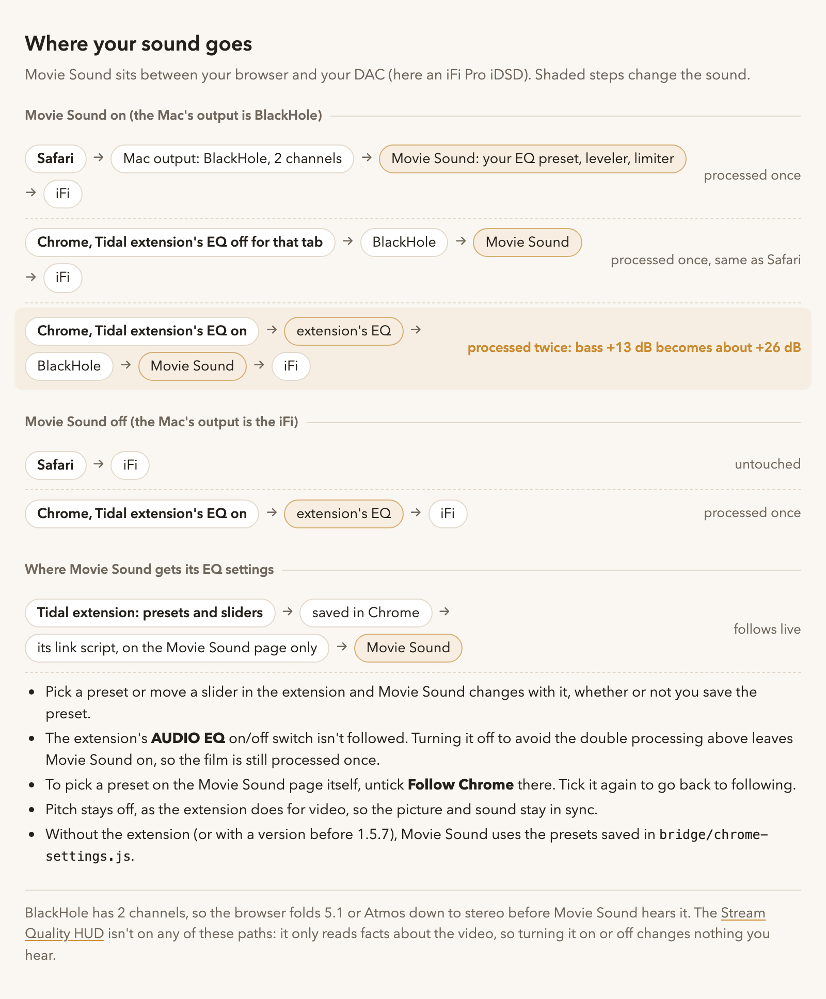

# Movie Sound

Your music EQ, for films in Safari. Movie Sound sends the Mac's sound through a small page in Chrome, which runs the same EQ, leveler and limiter as the [Tidal miniplayer extension](https://github.com/cornishandy/tidal-miniplayer-extension), then on to your DAC. Double-click to turn it on, and double-click again to turn it off.



**Why it works after the browser.** Streaming sites protect their video. An extension that taps a film's own sound in the page (`createMediaElementSource`) gets silence, or it breaks playback. So Movie Sound works further down the line instead:
1. Safari plays the film to BlackHole, a virtual audio device.
2. A local page in Chrome listens to BlackHole and runs the EQ chain.
3. That page plays the result to your DAC, which it picks by its exact device ID.

## What you need

- macOS with Google Chrome and [Node.js](https://nodejs.org/).
- [BlackHole 2ch](https://github.com/ExistentialAudio/BlackHole) (`brew install blackhole-2ch`) and [SwitchAudioSource](https://github.com/deweller/switchaudio-osx) (`brew install switchaudio-osx`).
- A USB DAC. It's set up for an **iFi Pro iDSD**. For another DAC, change `IFI` in `bin/movie-audio` and `isIfiProIdsd` in `bridge/bridge.js`.
- Optional: the Tidal miniplayer extension, 1.5.7 or later, in Chrome. With it, Movie Sound follows your EQ live (see the picture above).

## Install

1. Clone this repo anywhere.
2. Run `tools/install.sh`. It copies `bridge/` to `~/Library/Application Support/movie-sound/` and `bin/movie-audio` to `~/.local/bin/`.
3. Run `app/build.sh`. It builds `~/Applications/Movie Sound.app` and puts a link on your Desktop.
4. Allow **Movie Sound** under System Settings → Privacy & Security → Accessibility, so it can press Start on the page for you.
5. The first time, Chrome asks whether `http://127.0.0.1:8791` may use the microphone. That's how a web page hears BlackHole, so allow it. The page won't open a real microphone unless you tick its override box.

## Use

- **Double-click Movie Sound.** The Mac's sound goes through the bridge page, which starts and then tucks Chrome away. Double-click again and the sound goes straight to the DAC; the page closes and its server stops.
- **Change the EQ in the Tidal extension's popup.** Movie Sound follows the preset and the sliders as you change them, saved or not. Pitch stays off, as it does for video in the extension. To pick a preset on the bridge page instead, untick **Follow Chrome** there; tick it again to go back to following.
- **Lip sync:** the bridge page's clap button plays a click with a flash, so you can check the delay by eye and ear.

## What it touches

- **Sound output:** it switches the Mac's sound output between BlackHole and your DAC, and nothing else.
- **Local only:** a Chrome tab at `http://127.0.0.1:8791`, served by `bridge/server.mjs`, which listens only on this Mac.
- **Nothing leaves the Mac,** and nothing is recorded. The page won't open a real microphone unless you tick its override box, and it refuses BlackHole as an output, because that would feed the sound back into itself.
- **If the DAC disappears,** the page stops, rather than switching your film to the laptop speakers at full EQ.

## Repo layout

| Folder | What's in it |
|---|---|
| `bridge/` | The bridge page: `bridge.js` (the EQ chain, device picking, Follow Chrome), `index.html`, the two audio worklets (byte copies from the Tidal extension), `server.mjs`, and `chrome-settings.js` (a saved copy of the presets, used when the extension isn't linked). |
| `app/` | The double-click app: `Movie Sound.applescript`, `build.sh`, its icon, and a stand-in page for testing the Start press without audio. |
| `bin/movie-audio` | `on`, `off`, `status`, `is-on`: switches the sound output, opens or closes the page, and starts or stops the server. |
| `tools/` | `install.sh`; `import-chrome-audio-settings.mjs` refreshes `bridge/chrome-settings.js` from a read-only copy of Chrome's saved settings. |
| `tests/` | Silent checks in Node. No browser, and no audio device is opened. |
| `measurements/` | The levels from one scene of *Mother of Flies* (minutes 21–23), before and after the EQ, used to check the boost and the limiter. |
| `orion/` | Tools for the Orion browser, which this no longer uses. See `orion/README.md`. |
| `docs/` | The sound-path picture, [DECISIONS.md](docs/DECISIONS.md) and [SESSION_HANDOFF.md](docs/SESSION_HANDOFF.md). |

## Tests

```
npm test
```

This runs every file in `tests/`. The worklet byte-copy check looks for the Tidal extension at `~/Documents/ChatGPT/tidal-miniplayer-extension`, or wherever `TIDAL_EXTENSION_DIR` points.

## Licence

MIT. The audio chain in `bridge/` comes from the MIT-licensed [tidal-miniplayer-extension](https://github.com/cornishandy/tidal-miniplayer-extension), by the same author.
